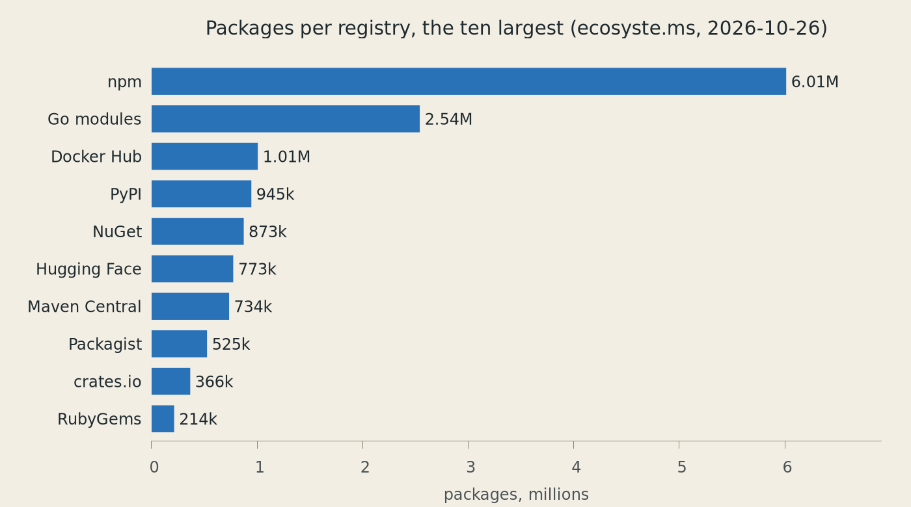
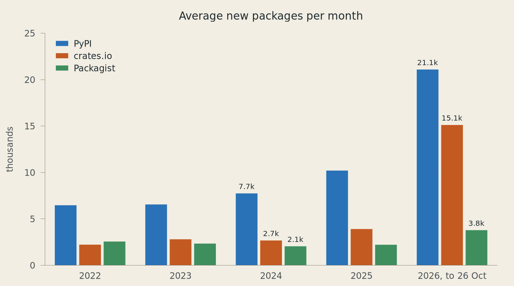
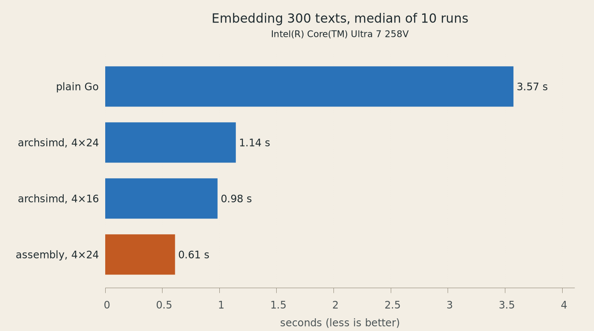

# Software Discovery

> Lightning Talk, Leipzig Gophers #61, Halle (Saale), 27 October 2026,
> [Martin Czygan](mailto:martin.czygan@gmail.com)

**silt**: a prior-art search for code ideas, ported from Rust to Go.

1. [Why look](#motivation) · 2. [How much is out there](#how-much-is-out-there)
· 3. [silt](#silt) · 4. [Porting](#in-a-port-the-spec-already-exists)
· 5. [Go constructs](#concurrency-in-a-handful-of-lines)
· 6. [Assembly](#what-minilm-does-in-silt)
· 7. [Curiosities](#same-request-different-answer)
· 8. [What's next](#open-questions)

---

## Motivation

I am working through my own [AI-assisted coding challenge list](https://github.com/miku/nightjet) and I like to look for prior art.

* **inspiration**: learn (stealing good ideas) from projects that solved problems before
* maybe, actually **reuse** code
* **relevance**: it is easier to look at an existing project and critique it or see the downsides (and some software, that made sense in the past, may not make sense today)

---

## Software reuse

> Software reuse is finally here but comes with risks.
>
> -- Russ Cox, "[Surviving Software Dependencies](https://dl.acm.org/doi/10.1145/3347446)", ACM Queue 17(2), 2019

Build or buy, 2026 edition:

| | |
|---|---|
| **Build is cheap** | small tailor-made tools take a few hours: [gh-repos](https://github.com/miku/gh-repos), [doclingclient](https://github.com/miku/doclingclient), [tldhunter](https://github.com/miku/tldhunter), … |
| **More to throwaway?** | interface-y code goes obsolete fast; a data access layer (databases, and the code that feeds them) may stay useful a bit longer |
| **No free tokens** | an LLM is expensive; anything that runs on software 1.0 looks lightning fast and cheap now |

---

## How much is out there?



* **16.2M packages** in the 117 registries [ecosyste.ms](https://ecosyste.ms)
  tracks (Linux distribution snapshots included).
* Hugging Face models now rank 6th, ahead of Maven Central.
* Counts disagree: PyPI itself says **925,843** projects, ecosyste.ms 945,180.

---

## Packages arrive faster than ever



* **crates.io:** about **17,700 new crates a month** since June 2026, 6.6×
  the rate of 2024 (2,700).
* **PyPI:** 925,843 projects, 206,475 of them new this year: more than in
  any full year before.
* **Packagist** (PHP), for comparison: 2,050 a month in 2024, 3,790 this
  year (1.8×).
* My guess, not proven: agentic coding makes publishing a package cheap.

No registry publishes its history, so the counts come from Wayback Machine
snapshots of the crates.io API, the PyPI front page and Packagist's
statistics. npm is left out: spam waves and a new replication backend in 2026
make its counts incomparable.

---

## silt

Has this dev tool already been shipped?

```
 "cli tool that kills a       fan-out               rank                    verdict
  process on a given port" ─▶ 19 sources, picked ─▶ all-MiniLM-L6-v2, ─▶   Open / Crowded / Saturated
                              from the idea;        in pure Go; cosine      from an LLM or the data
                              15 s each, 1 retry    similarity              alone; = exit code 0/1/2
```


> silt can prove that something **exists**, but never that it **doesn't**: it
> only searched some sources.

A Go port of [patent](https://github.com/r14dd/patent) 0.14.1 (Rust, MIT).
Thanks [Riad](https://github.com/r14dd) and greetings to
[Baku](https://en.wikipedia.org/wiki/Baku).

---

## Rust to Go, some numbers

| | |
|---|---|
| **23 h** | from the first commit (Sat 25 Oct, 14:00) to v0.1.0 (Sun 26 Oct, 12:53) |
| **397** | patent tests as the spec: each one has a Go counterpart, or a written reason why not ([parity-tests.md](../parity-tests.md)) |
| **8.3k → 8.8k** | lines of Rust → lines of Go, plus 157 of assembly; tests 6.3k → 8.1k |
| **33 / 33** | reference ideas get the same verdict level; similarities agree within 8.9e-7 ([parity report](../2026-10-26-parity.md)) |

---

## In a port, the spec already exists


| | Greenfield | Port |
|---|---|---|
| **Spec** | in your head, and moving | 397 tests and a binary to run |
| **Done when** | it feels done | no unexplained differences |
| **Decisions** | all open | made, thresholds calibrated |
| **Checking** | review, and hope | golden files, side-by-side runs |
| **Unknowns** | everywhere | few, named, spiked first |

The price: you inherit the quirks, maybe bugs, maybe a design that is slightly off.

---

## Making "the same" checkable

* **[patent-harness](../../scripts/patent-harness):** a Rust crate that links
  patent at the reference commit and records its outputs: 51 embeddings,
  146 LLM replies, …
* **[parity-tests.md](../parity-tests.md):** generated from patent's test
  names: each Rust test, its Go test, or n/a with a reason.
* **[scripts/parity](../../scripts/parity):** runs both binaries at the same
  moment on 33 ideas; compares sources, match URLs, levels and similarities.
* **[httprec](../../internal/httprec):** a recording `http.RoundTripper`:
  replay a live fan-out offline, the same way every time.
* **Planted bugs:** Go's lowercasing, a dropped phrase, a "fixed"
  `isWholeWord`: each one must fail the tests.

Result: 33 of 33 verdict levels agree; similarities differ by at most 8.9e-7
(the tolerance was 1e-3).

Verification becomes the key.

---

## A port is a also code review

Found in patent 0.14.1:

| | |
|---|---|
| `9999-12-31T23:00:00-02:00` | the offset moves the date past year 9999: patent panics, and the whole run dies |
| pad batch to longest text | one 720-word description among 300 matches: ranking takes 17–25 s instead of 1.2 s |
| `HashSet` iteration | which duplicate wins dedup changes from run to run |
| `is_whole_word("atat …", "at")` | true: a gap is dropped as if it named the match "at" |
| "~80 MB, one-time" | the model files are 91 MB |

---

## Same idea, different semantics

| Rust (patent) | Go | silt |
|---|---|---|
| `is_alphanumeric`, `to_lowercase` | `unicode.IsLetter`, `strings.ToLower` | `internal/textutil`, tested against rustc (İ, final sigma, circled letters) |
| missing field → error | missing field → zero value | required fields as pointers: drift reads "not reached", never "no prior art" |
| `<` stays `<` | `<` becomes `<` | `SetEscapeHTML(false)` |
| empty `Vec` → `[]` | nil slice → `null` | empty, non-nil slices |
| `sort_by` is stable | `slices.SortFunc` is not | `slices.SortStableFunc` |

Each one shows up as a diff against patent's golden files.

---

## Concurrency in a handful of lines

The whole fan-out, [sources/sources.go](../../sources/sources.go):

```go
results := make([]result, len(adapters))
var wg sync.WaitGroup
for i, a := range adapters {
	wg.Go(func() { results[i] = f.searchOne(ctx, a, q) })
}
wg.Wait()
```

* `wg.Go` (Go 1.25): `Add`, `go` and `Done` in one call.
* `i`, `a` are new in each iteration (Go 1.22): no more `i := i`.
* One slot per adapter: no mutex, and the output keeps adapter order.

The embedding workers, [internal/minilm/model.go](../../internal/minilm/model.go):

```go
next := make(chan int)
for range min(runtime.GOMAXPROCS(0), len(texts)) {
	wg.Go(func() {
		for i := range next {
			out[i] = m.EmbedOne(texts[i])
		}
	})
}
```

`for range n` (Go 1.22) and the `min` builtin (Go 1.21): one worker per core.

---

## Small things from recent releases

| Construct | Since | In silt |
|---|---|---|
| `sync.WaitGroup.Go` | 1.25 | fan-out, Hackage fetches, embedding workers |
| `for b.Loop() { … }` | 1.24 | benchmarks: the setup stays out of the timing |
| `t.Context()` | 1.24 | 31 uses: a context that ends with the test |
| `cmp.Or(cmp.Compare(…), …)` | 1.22 | multi-key sort of recorded HTTP exchanges |
| `sync.OnceValues` | 1.21 | one 90 MB model, shared by all tests |
| `Lenient[T any]` | 1.18 | a date field that changes type is "no date", not a failed source |
| `errors.AsType[E](err)` | 1.26 | not yet: `errors.As(err, new(*silt.ParseError))` |

---

## What MiniLM does in silt

```
"kill-port: kill a process on a port" ─▶ WordPiece tokens ─▶ 6 transformer layers ─▶ mean pooling ─▶ 384 floats
```

* [all-MiniLM-L6-v2](https://huggingface.co/sentence-transformers/all-MiniLM-L6-v2)
  is a small sentence-embedding model: 22M parameters, 90 MB. Similar
  meaning, nearby vectors. Quite popular: 190M downloads, last month (09/2026)

> This is a sentence-transformers model: It maps sentences & paragraphs to a
> 384 dimensional dense vector space and can be used for tasks like clustering
> or semantic search.

* silt embeds the idea and every match (`name: description`) and sorts by
  cosine similarity.
* The numbers gate the verdict:

| Similarity | Verdict |
|---|---|
| best < 0.35 | nothing relevant, no LLM call |
| 5 matches ≥ 0.60 | at least Saturated |
| 2 ≥ 0.55, or 1 ≥ 0.70 | at least Crowded |

---

## Decision D2: the embedding backend

| Backend | Accuracy vs patent | 300 texts |
|---|---|---:|
| patent: fastembed, ONNX Runtime | reference | 1.13–1.44 s |
| hugot 0.8.3, pure-Go backend | 2 of 51 texts wrong | 14.6–17.1 s |
| silt, plain Go | within 7.7e-7 | 5.4 s |
| **silt, AVX2 + FMA kernel** | within 7.4e-7 | **0.86–0.92 s** |

* **Not ONNX Runtime:** cgo, a shared library, and glibc ≥ 2.38. silt stays
  a static binary.
* **Not hugot:** splits words at a zero-width space (1 − cos = 0.45), no
  truncation, 15× slower.
* **Hand-written:** tokenizer, forward pass, float32 `erf` and `exp`; weights
  read from `model.onnx` in ~200 lines of protobuf reading.

Measured on an Intel Core Ultra 7 258V ([decisions.md](../decisions.md)).

---

## 83 lines of assembly

[internal/minilm/matmul_amd64.s](../../internal/minilm/matmul_amd64.s):

```asm
loop24:
	VMOVUPS      (DI), Y12      // w[k][0:8]
	VMOVUPS      32(DI), Y13    // w[k][8:16]
	VMOVUPS      64(DI), Y14    // w[k][16:24]
	VBROADCASTSS (SI), Y15      // x[0][k], 8 times
	VFMADD231PS  Y12, Y15, Y0   // d[0][0:8] += …
	VFMADD231PS  Y13, Y15, Y1
	VFMADD231PS  Y14, Y15, Y2
	VBROADCASTSS (R11), Y15     // x[1][k] …
	…                           // rows 1–3: Y3–Y11
	ADDQ         R9, DI         // next row of w
	DECQ         CX
	JNZ          loop24
```

* **A 4 × 24 tile:** 12 accumulators, 3 vectors of `w`, 1 broadcast: all 16
  YMM registers. A 4 × 16 tile with 8 was 10% slower.
* **One file per platform:** `matmul_amd64.s` (AVX2, FMA), `matmul_arm64.s`
  (NEON, 4 × 16), `matmul_other.go` (plain Go, `//go:build !amd64 && !arm64`).
* **Checked at run time:**
  `var hasKernel = cpu.X86.HasAVX2 && cpu.X86.HasFMA`, a variable, so tests
  can switch to the plain-Go path.

---

## Measure it with benchstat

Sub-benchmarks, one per kernel ([archsimd.patch](archsimd.patch)):

```go
func BenchmarkKernel(b *testing.B) {
	m := loadModel(b)
	texts := benchTexts(b, 300)
	for _, k := range kernels {
		b.Run(fmt.Sprintf("kernel=%s", k.name), func(b *testing.B) {
			useKernel(b, k.asm, k.simdCols)
			for b.Loop() { // Go 1.24: the setup above is not timed
				m.Embed(texts)
			}
		})
	}
}
```

```
$ go test -run '^$' -bench '^BenchmarkKernel$' -count 10 ./internal/minilm > bench.txt
$ benchstat -col /kernel -filter '/kernel:(go OR asm)' bench.txt
         │      go       │                 asm                 │
         │    sec/op     │   sec/op     vs base                │
Kernel-8   3572.5m ± 18%   611.3m ± 8%  -82.89% (p=0.000 n=10)
```

* **`-count` and benchstat:** a median, a ± range and a p-value, not one
  lucky number. `-col /kernel` turns the sub-benchmark key into columns;
  all four kernels: [data/benchstat.txt](data/benchstat.txt).
* **Watch the ±:** a warm laptop drifts. Tonight, two runs came back with
  ±36% and ±44%, the third with ±8–18%. `-count` runs each sub-benchmark n
  times in a row, so the drift hits the kernels unevenly;
  [scripts/bench.sh](scripts/bench.sh) runs whole rounds instead.
* **One session, one machine:** on another day the same pair measured 5.4 s
  and 0.9 s.
* **Correct first:** the golden tests run on every kernel. Under `-race` they
  are skipped (30× slower).

---

## The same kernel, without assembly

Go 1.26 added [simd/archsimd](https://pkg.go.dev/simd/archsimd), behind
`GOEXPERIMENT=simd` (amd64 only, for now):

```go
for p := range k {
	wp := w[p*ws : p*ws+24]
	w0 := archsimd.LoadFloat32x8(wp[0:8]) // w1, w2 likewise
	a := archsimd.BroadcastFloat32x8(x0[p])
	c0, c1, c2 = w0.MulAdd(a, c0), w1.MulAdd(a, c1), w2.MulAdd(a, c2)
	// … the same for rows x1, x2, x3
}
```



* **Correct:** the same golden-test results as the assembly.
* **Fast, but not yet fast enough:** 3.1–3.6× faster than plain Go, while
  the assembly is still 1.6–1.9× ahead.
* **Why:** in the 4 × 24 tile the compiler spills two of the twelve
  accumulators to the stack; the 4 × 16 tile has no spills. In both, the
  slice bounds checks stay in the inner loop
  (`go build -gcflags=-d=ssa/check_bce`).

An experiment, not part of silt: [archsimd.patch](archsimd.patch), run by
`make bench`.

---

## Same request, different answer

* **Docker Hub:** 8 identical searches for "container kubernetes logging": 3
  different orders ([data/docker-hub.txt](data/docker-hub.txt)). Near the
  cut-off at 20, a swap changes the result set.
* **GitHub:** same query, same moment: patent got 35 results, silt 27,
  normally 50. Rerun: 50 each time, `incomplete_results: false`.
* **Hacker News (Algolia):** 17 stories for patent, 19 for silt, for the same
  query at the same moment.
* **patent itself:** the fan-out iterates a Rust `HashSet`: which duplicate
  wins dedup changes from run to run.

So the parity harness has to tell registry noise from real differences:
rerun the idea, or replay a recording.

---

## 19 registries, 19 dialects

| | |
|---|---|
| **PyPI** | search is bot-walled with a 403, so PyPI always shows up as "not reached" |
| **VS Code Marketplace** | send `flags: 914`, or `lastUpdated` is silently dropped from the reply |
| **Hex** | a multi-word query returns the whole catalogue, so silt searches each keyword on its own |
| **AUR** | HTTP 200 with `{"type":"error"}` is a refusal, not an empty result |
| **Nixpkgs** | search.nixos.org is Elasticsearch, with credentials shipped to every browser |
| **Docker Hub** | more words, more hits: "kubernetes logging" 51,864, "container kubernetes logging" 176,430 |
| **qwen3.5 via Ollama's OpenAI API** | spends all 2048 tokens thinking and returns an empty answer |

---

## Software 1.0 that made this possible

Linux · a terminal · bash · git · Go 1.27 · `go test -race` · benchstat ·
golangci-lint · goreleaser · GitHub Actions · cargo and rustc · Python · qemu
· pyte · curl · jq · gnuplot · vhs · Ollama · the Wayback Machine ·
ecosyste.ms · 19 registry APIs

Fast, cheap and deterministic. Mostly.

---

## Open questions

* **A harvested index** instead of a live fan-out: crates.io dumps, the npm
  changes feed, the PyPI simple index, index.golang.org, …
* **Which signals?** Stars, downloads, dependents, last release, licence:
  side by side, not merged into one number.
* **Which level?** Reuse and discovery of a function, a package, or a whole
  tool?
* **Why discover?** With 17,700 new crates a month, is finding still
  cheaper than generating?

**Thank you!** [github.com/miku/silt](https://github.com/miku/silt) ·
[github.com/r14dd/patent](https://github.com/r14dd/patent)

---

## Reproducing

Everything on these pages can be regenerated from this directory:

| | |
|---|---|
| `make` | the charts in [img/](img), from [data/](data), with gnuplot ([plots/](plots)) |
| `make data` | registry counts from ecosyste.ms, their history from the Wayback Machine, the Docker Hub check ([scripts/](scripts)) |
| `make bench` | benchmarks plain Go, the assembly and two simd/archsimd tiles in one session, on a copy of the tree with [archsimd.patch](archsimd.patch) applied (amd64 with AVX2, Go 1.26+, the model in silt's cache) |
| `make demo` | records [img/demo.gif](img/demo.gif) with [vhs](https://github.com/charmbracelet/vhs) ([demo.tape](demo.tape)) |
